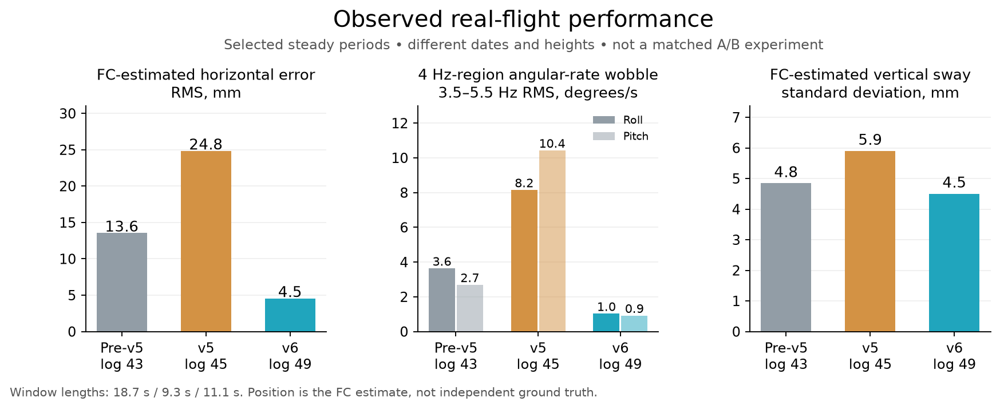

# v6 real-flight comparison — 6 November 2026

The intended reduction in the old 4–5 Hz oscillation is visible in real flight data. This is encouraging evidence of transfer from simulation, but it is not a controlled measurement of the simulator's exact improvement percentage.

## Measured steady periods

| Metric | Earlier setup, log 43 | v5, log 45 | v6, log 49 |
|---|---:|---:|---:|
| Selected window | 18.7 s | 9.3 s | 11.1 s |
| FC-estimated horizontal tracking RMS, including bias | 13.6 mm | 24.8 mm | 4.5 mm |
| FC-estimated horizontal sway RMS, mean removed | 10.9 mm | 16.6 mm | 4.5 mm |
| Roll-rate RMS, 3.5–5.5 Hz | 3.64 °/s | 8.16 °/s | 1.03 °/s |
| Pitch-rate RMS, 3.5–5.5 Hz | 2.70 °/s | 10.43 °/s | 0.92 °/s |
| Vertical sway, standard deviation | 4.8 mm | 5.9 mm | 4.5 mm |
| Roll / pitch angle standard deviation | 0.25° / 0.22° | 0.32° / 0.47° | 0.27° / 0.23° |

The v6 window has about 87% less roll-rate amplitude and 91% less pitch-rate amplitude in the 3.5–5.5 Hz band than the selected v5 window. These are observed RMS ratios between these flights, not a guaranteed causal performance gain. Overall attitude motion is close to the earlier, less aggressive log-43 setup: suppressing the fast oscillation has not removed slower sway.

The earlier camera analysis gave roughly 6.0–6.4 mm horizontal RMS across the two longer v6 recordings, including height changes. The simulator reported 4.0–5.7 mm on **true simulated position** in a 30-second, 2 cm hold. The real FC and camera measurements are estimates, and the camera is also the feedback sensor. Those figures cannot establish identical absolute positioning accuracy.

## What the full onboard log adds

- All 25 entries in `tune_v6.parm` match the parameter snapshot in log 49.
- In its selected steady interval, the recorded IMU clipping counters were zero. Vibration metrics peaked at approximately 4.05 / 4.30 / 4.46 m/s² across the recorded IMUs.
- Motor outputs in that interval ranged from 1424 to 1562 against configured 1000–2000 limits; they did not approach either output limit.
- The logged errors in log 49 occurred about 7.9 seconds after disarm, outside the scored hold.
- Logs 48 and 50 do not supply a three-second steady window under the same strict selection rule, so they are excluded from this comparison rather than assigned misleading hover scores.

## Method and limits

Start five seconds after the first takeoff handover. End before landing or a target change larger than 1 mm horizontally / 5 mm vertically, with a short margin before the change. Interpolate controller records onto a 400 Hz grid and compute the same quantities for each flight. Horizontal tracking RMS includes mean offset; sway removes it. Angular-rate band RMS uses an FFT band selection from 3.5 to 5.5 Hz.

The flights differ in date, height, duration and operating conditions. v6 also changes camera lever-arm correction and estimator parameters, which can change the estimated position error without an equal change in physical motion. The translated-position comparison therefore needs independent position measurement before it can become a physical accuracy claim. The angular-rate reduction is stronger evidence that the intended oscillation suppression transferred.

A useful next validation is repeated, fixed-height 30-second holds under the same conditions, with separate target-step tests. The remaining priorities are slow sway, vertical settling and repeatable takeoff handover slide; the present data does not justify raising gains blindly.

## Post-flight data path

The Pi now records telemetry during flight and generates a summary on a disarmed FC heartbeat. It includes camera/FC tracking, available telemetry-band wobble, voltage and event data. A laptop login service mirrors the small files every two seconds over Wi-Fi while a separate worker copies full logs and JPEGs. Missing inputs are reported as unavailable.

This is an immediate **camera/telemetry** summary, not immediate availability of every raw onboard sample. Log 50 contained 6,787,072 bytes over 32.14 seconds: about 211 KB/s, including controller records at about 400 Hz. A 2 Mbaud 8N1 serial link carries at most 200 KB/s before MAVLink framing overhead. Streaming every raw record over this connection is therefore infeasible at the existing logging rate. Full-resolution SD logging is retained and archived after flight.

Synthetic UDP tests validate summary generation and routing; real-flight report latency and arming during an active background download still require a normal user-flown test. No test flight was commanded by the assistant.

## Archive and deployment verification

- 50 onboard logs, totaling 293,040,401 bytes, are present locally; every file matches the current FC inventory size.
- Seven newly retrieved files (16, 17, 46–50) match the FC CRC32 and their laptop SHA256 manifests. The remaining 43 were recovered from the existing local archive.
- 40 historical/current camera-recording folders are retained locally. The synchronizer never deletes local history when the Pi rotates its recordings.
- Camera, MAVLink tunnel, flight recorder and automatic archive timer are active. The laptop login synchronizer is running.
- Normal shared-link validation: log 2, 434,176 bytes, completed in 28.3 seconds with FC CRC verification; camera telemetry then reported 9.8 Hz and 0% skipped frames.
- Eight pipeline tests and 18 hover-control tests pass. Python compile and inline JavaScript syntax checks pass. No static Python type checker is configured.
- Physical arming during background transfer and actual next-flight report latency remain untested. No flight or arming command was issued for this work.

The source changes are on the fork's master branch and in upstream PR #17. Raw recordings are kept in the local archive, not uploaded as Git source files.
