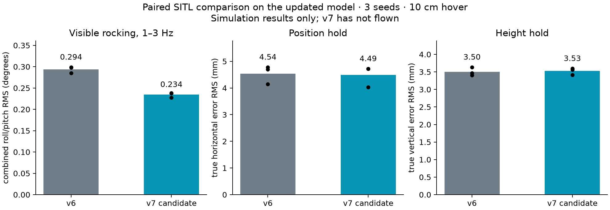

# v7: simulation-only hover tuning

**Status: candidate tested in simulation; not installed or flown on the drone.**

Only roll/pitch rate P changes, from **0.22 to 0.26**. The other 23 v6 parameters, angle gains, position controller and operational failsafes remain unchanged. The parameter file is `tools/tune_v7.parm`.

## Paired nominal results

Three identical-seed comparisons, 10 cm hover, 30 s commanded hold (28 s scored after settling). Values below are simulator truth, not measured v7 flight performance.

| Metric | v6 mean | v7 mean | Change |
|---|---:|---:|---:|
| 1–3 Hz rocking RMS, combined roll/pitch (°) | 0.294 | 0.234 | -20.3% |
| Rocking above 1 Hz RMS (°) | 0.299 | 0.242 | -19.0% |
| Roll peak-to-peak (°) | 1.618 | 1.475 | -8.8% |
| Pitch peak-to-peak (°) | 1.710 | 1.530 | -10.5% |
| Horizontal position RMS (mm) | 4.539 | 4.492 | -1.0% |
| Vertical position RMS (mm) | 3.500 | 3.525 | +0.7% |

## Robustness results

Each row uses the same seed and disturbance model for v6 and v7. “Completed” refers to hover plus the direct runner’s descent; that runner subsequently force-disarms and is not the landing validation.

| Case | v6 rocking >1 Hz (° RMS) | v7 rocking (° RMS) | v6 XY RMS (mm) | v7 XY RMS (mm) |
|---|---:|---:|---:|---:|
| nom1 | 0.304 | 0.246 | 4.14 | 4.04 |
| nom2 | 0.304 | 0.247 | 4.78 | 4.72 |
| nom3 | 0.290 | 0.234 | 4.70 | 4.72 |
| low | 0.294 | 0.248 | 5.32 | 5.27 |
| old | 0.316 | 0.260 | 5.73 | 5.63 |
| strong | 0.212 | 0.185 | 4.03 | 3.98 |
| weak | 2.079 | 0.605 | 6.26 | 5.00 |
| latency | 0.399 | 0.300 | 12.45 | 12.14 |
| noise | 0.311 | 0.263 | 5.44 | 5.27 |
| gust | 0.277 | 0.247 | 7.22 | 6.96 |
| slow | 0.436 | 0.355 | 4.61 | 4.38 |

Scenarios: nominal seeds 1–3; 2 cm hover; old plant; stronger motors; raw weak-response fit; increased processing/readout delay; camera noise; a 0.3 m/s² one-second gust; slower motors. See `final_validation.json` for exact values. These are separate stress cases, not exhaustive combinations.

## Real-code landing checks

- **nominal:** test run done: landed, motors off. Landing began 33.31 s after press; FC disarmed at 37.14 s. The simulator ran at 1.000× wall time.
- **camera_loss:** camera-loss landing ended; FC disarmed. Landing began 29.23 s after press; FC disarmed at 32.15 s. The simulator ran at 1.000× wall time.
- Both use the actual ground-control server/hover code and the exact v7 file. All 25 candidate parameters were read back from each SITL DataFlash log and matched. Camera loss is a two-second blackout; the existing 0.5-second timeout requests LAND. No physical vehicle was connected by these tests.

## Fit to the latest flight

Log 49 is the latest substantial v6 flight; log 50 is too short for a comparable steady hover. The archive still ends at log 50. `fit.json` includes the log49 SHA256 and matching camera-recording timing statistics.

The motor-response regression uses 150–180 s for fitting and 180–205 s for validation. Holdout R² is only 0.25 on roll and 0.47 on pitch. The raw estimate is not a uniquely identified physical plant: closed-loop disturbances and sensor filtering bias it. It overpredicts wobble when applied directly, so it is retained as a stress case.

The calibrated nominal model uses effective torque-response gains of approximately 73.5/73.7 rad/s² per control unit, 15 ms motor lag and 30 ms pure delay. Its effective inertias are 0.1618/0.1613 kg·m²; these are response-equivalent values, not measured CAD inertias. Camera processing median is 68.7 ms versus the old 50 ms assumption. The measured 153.5 ms processing p95 is exercised in the latency stress case rather than claimed as a fitted nominal distribution.

Calibration uses a fixed-target 11.136 s window (150.369345–161.505510 s), high-rate ANG spectra and position tracking. Real 1–3 Hz tilt RMS is 0.189° roll / 0.187° pitch; nominal seed-1 v6 simulation gives 0.182° / 0.222°. Its FC-estimated XY error is 3.53 mm versus real 4.57 mm, so the simulator still understates that measurement by about 23%. Matching one spectrum is calibration, not independent validation. Camera noise, geometry, force disturbances and exposure latency remain inherited assumptions.

## Rejected candidates

- Reducing angle P alone to 6 slightly worsened nominal rocking and position hold.
- Raising rate D from 0.006 to 0.008 improved nominal rocking but produced approximately 1.14° RMS rocking in the stronger-motor case, versus 0.21° with v6. Staying airborne was not enough to pass.
- Softer rate P or reduced D in the weak-response search triggered the simulated tilt motor-off guard. All rejected outcomes remain in `results.json`; they are not averaged out.

## Verification and limits

- 11/11 exact-v7-file hover scenarios completed and produced scores; both final-file real-code landing checks completed with FC disarm.
- Synthetic known-motion test: 1 passed; hover controls and flight pipeline: 26 passed. Python compilation passed. No configured static Python type checker was run.
- The original simulator model and v6 parameter file are preserved. No production flight-control code or live parameters were changed.
- This reduces simulated wobble; it does **not** establish a rock-still physical hover. Prop/frame flexibility, thermal effects, hardware vibration and long-duration flights are not qualified. No independent external position ground truth is available.
- Physical v7 performance and transfer of the predicted improvement remain unverified. The next physical comparison needs the same height, targets, battery/payload configuration and a sufficiently long stationary hold; compare ANG/RATE spectra and position error with log49.

Reproduction: `README.md`; exact models/configurations and compact outcomes are kept beside this report. Tuning reference: [ArduPilot initial tuning](https://ardupilot.org/copter/docs/initial-tuning-flight.html).
